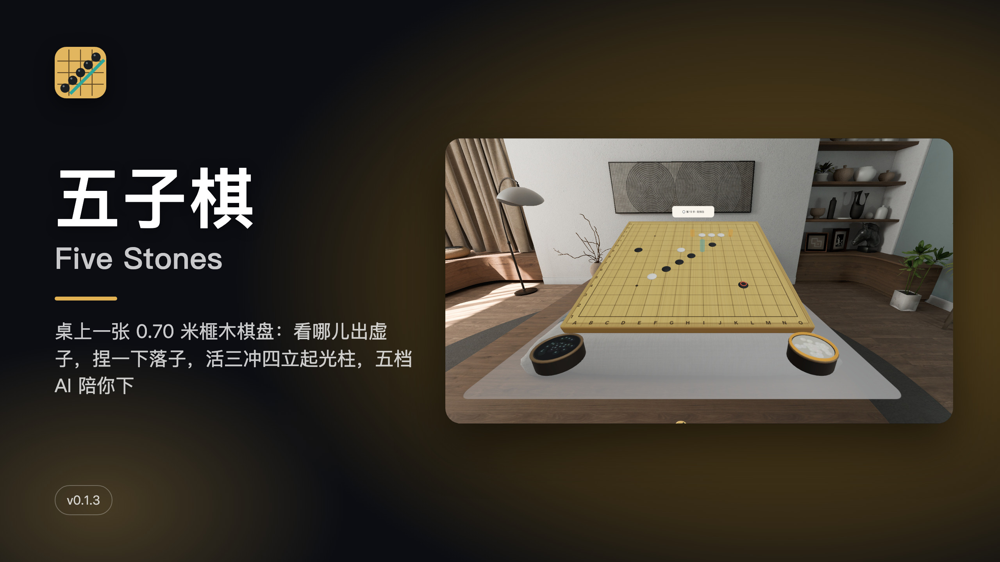
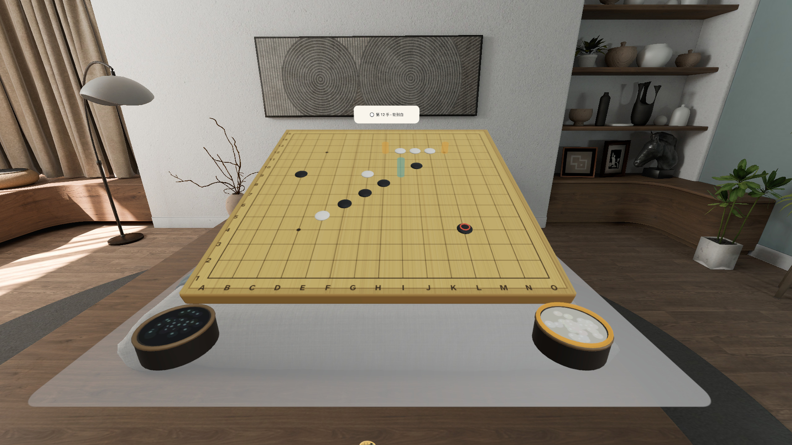
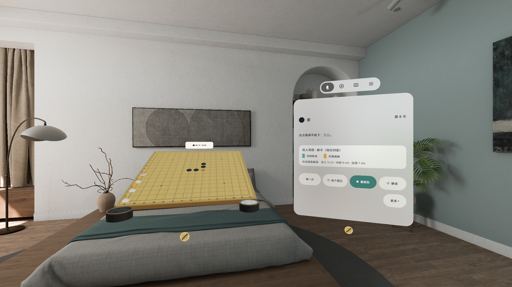
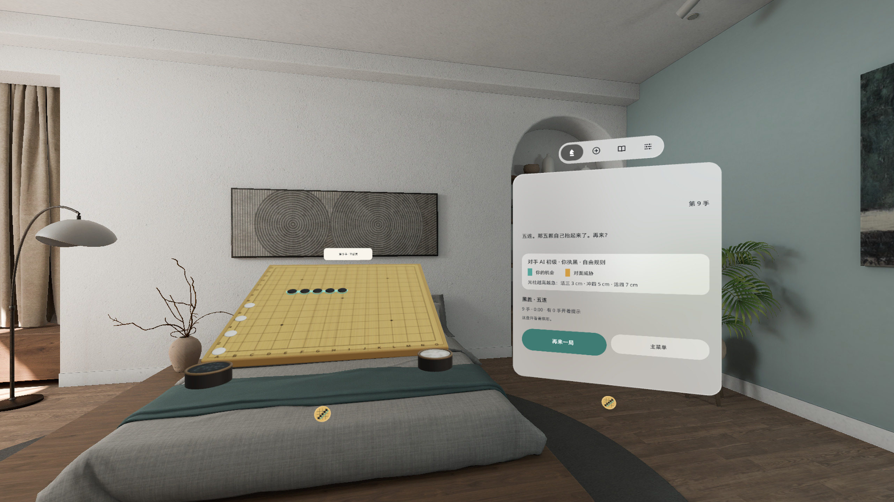
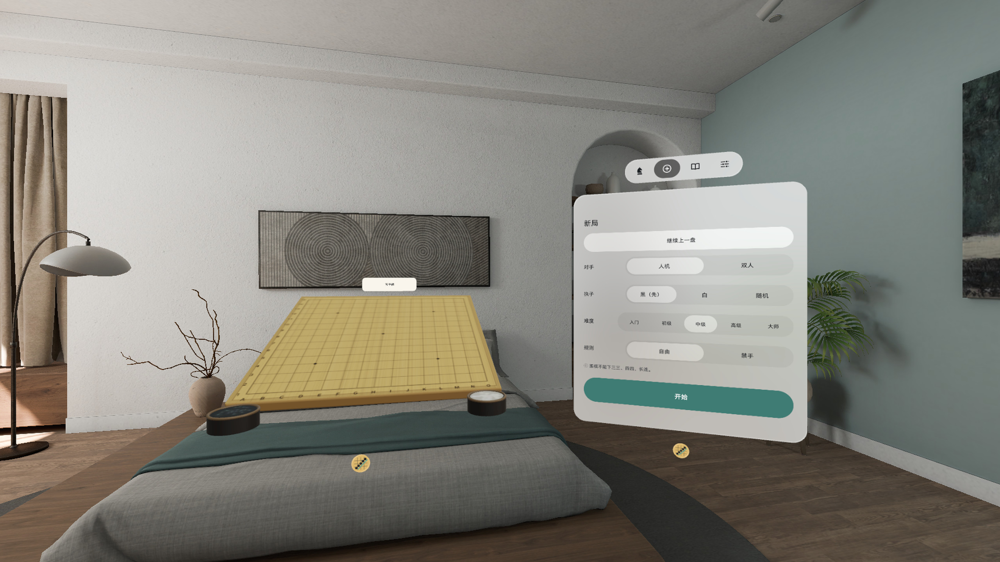
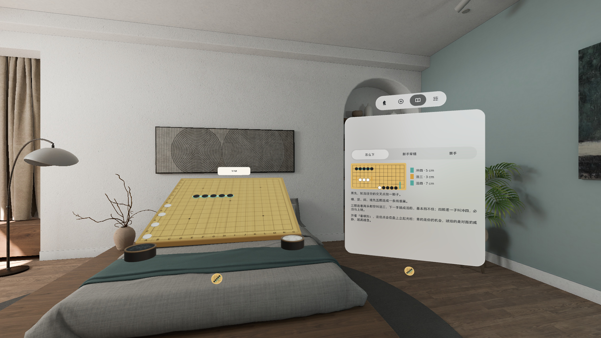

# 五子棋 Five Stones (PICO Spatial)



**中文** · [English](#english)

一张 0.70 米的 15 路榧木棋盘摆在你面前的桌上，左右两罐云子。看向哪个交叉点，那里就出现一颗半透明的虚子；捏一下，棋子从罐里沿弧线飞过去落下。五颗连上，那五颗一起抬起来发光。

- 人机对战：入门 / 初级 / 中级 / 高级 / 大师五档 AI，全部在本机计算；也可以双人同机轮流下
- 自由规则或禁手（三三、四四、长连，简化判定）随时切换
- 「看棋形」：活三、冲四、活四在盘上立起高低不同的光柱，青色是你的机会，琥珀色是对面的威胁
- 落子后 0.5 秒内再点一下可撤回，另有悔一步、给个提示
- 控制窗是系统原生页签：对局 / 新局 / 规则 / 设置；棋盘倾角、大小可调；中途退出自动保存
- 手势捏合 + 手柄射线；中英双语；全部离线，不联网、不需要账号

当前版本 **v0.1.3**，PICO OS 6（Android 15，minSdk 35），PICO Spatial SDK 6.1.9。

### 截图

> 截图和演示视频都在 PICO 模拟器里拍，由调试广播驱动，**非真实手势录像**。

| | |
|---|---|
|  中级 AI 在想，「看棋形」光柱标出双方的活三和冲四 |  对局中：棋盘和右侧的控制窗 |
|  禁手开着：黑棋点在三三点上，红 ✕ 提示原因 |  五连：五颗棋子抬起发光，再来一局 |
|  新局：人机 / 双人、执子、五档难度、规则 |  规则 · 怎么下：小棋盘图示棋形 |

### 安装

从 [Releases](https://github.com/kejing-dev/FiveStones/releases) 下载 APK，接上头显后：

```bash
adb install -r FiveStones-v0.1.3-debug.apk
pico-cli app launch io.embodit.fivestones
```

Release 里另有 `FiveStones-v0.1.3.apk`（`assembleRelease` 未签名包，给应用商店上架用，需要先签名才能 `adb install`）。

### 自己构建

```bash
export JAVA_HOME=<JDK 17+>
./gradlew assembleDebug :app:testDebugUnitTest
```

结构、调试广播和状态清单见 [AGENTS.md](AGENTS.md)。

### 已知问题（v0.1.3）

- 规则页、认输确认页内容偏少，窗内空白偏大
- AI 高级档对中级档的强度差距偏小（不同随机种子下胜率约 50–80%）
- 大师档每手约需 2 秒
- 控制窗首次打开时，约三分之一的几率落在模拟器视野外（真机上未观察到）
- 手数牌上的字偏小

---

<a id="english"></a>

## English

A 0.70 m, 15 × 15 kaya board sits on the table in front of you with a bowl of stones on each side. Look at a point
and a translucent ghost stone appears there; pinch, and a stone flies from the bowl and lands. When five line up,
those five lift and glow.

- Play the AI at five levels (Starter / Easy / Medium / Hard / Master, all on-device) or two players on one headset
- Free rules or forbidden moves (double three, double four, overline; simplified renju) at any time
- **Shapes**: open threes, fours and open fours raise light pillars of different heights on the board, teal for
  your chances and amber for your opponent's threats
- Tap the same stone within 0.5 s to take it back; undo and hint buttons
- Control window uses the native system tab bar (Play / New game / Rules / Settings); board tilt and size are
  adjustable; the game saves itself when you leave
- Hand pinch and controller ray; Chinese and English; fully offline, no account

Current version **v0.1.3**, PICO OS 6 (Android 15, minSdk 35), PICO Spatial SDK 6.1.9.

Screenshots and the demo video were captured in the PICO emulator, driven by debug broadcasts: **not a recording of
real hand gestures**.

### Install

Download the APK from [Releases](https://github.com/kejing-dev/FiveStones/releases), connect the headset, then:

```bash
adb install -r FiveStones-v0.1.3-debug.apk
pico-cli app launch io.embodit.fivestones
```

`FiveStones-v0.1.3.apk` in the release is the unsigned `assembleRelease` build for store submission; sign it before
installing with adb.

### Build

```bash
export JAVA_HOME=<JDK 17+>
./gradlew assembleDebug :app:testDebugUnitTest
```

See [AGENTS.md](AGENTS.md) for structure, the debug broadcast and the state list.

### Known issues (v0.1.3)

- The Rules pages and the resign confirmation have little content and a lot of empty space
- The Hard AI level is only slightly stronger than Medium (about 50–80 % across random seeds)
- The Master level takes about 2 s per move
- About one time in three, the control window first opens outside the emulator view (not seen on a headset)
- The move-count plate text is small

---

Fonts: Noto Sans / Noto Sans SC (SIL OFL 1.1, `third_party/noto-sans`). Icons: PICO ICON 7.0.
